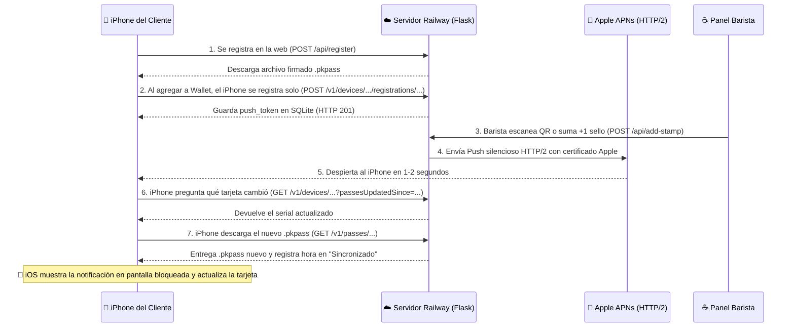

# ☕️ Documentación Técnica y Funcional — Sistema de Fidelización Apple Wallet (Maishas Café)

Este documento describe de forma integral la arquitectura, tecnologías, almacenamiento de datos, seguridad y funcionalidades del sistema de tarjetas de fidelización digitales para **Apple Wallet** desarrollado para **Maishas Café** (y preparado como base para escalar a múltiples negocios en modelo SaaS / Agencia).

---

## 🌐 1. Enlaces y Accesos en Producción

* **Página Pública de Registro de Clientes:**  
  `https://web-production-98096.up.railway.app/`
* **Panel Privado del Barista / Administrador:**  
  `https://web-production-98096.up.railway.app/barista`
  * **Usuario por defecto:** `maishas`
  * **Contraseña por defecto:** `cafe2026` *(configurable desde la variable `BARISTA_PASSWORD` en Railway)*
* **Diagnóstico Técnico del Servidor (JSON):**  
  `https://web-production-98096.up.railway.app/api/diagnostics` *(requiere credenciales del barista)*
* **Repositorio de Código (GitHub):**  
  `https://github.com/gonzaloggg/maishas-wallet-backend.git`

---

## ✨ 2. Funcionalidades Principales del Sistema

### A. Portal de Registro de Clientes (`/`)
1. **Formulario optimizado para móviles (Safari iOS):**
   * **Nombre y Apellido** *(Obligatorio)*
   * **Correo Electrónico** *(Obligatorio)*
   * **Número de Celular** *(Opcional)*
   * **🎂 Fecha de Nacimiento** *(Opcional — pensado para promociones de cumpleaños)*
2. **Generación y descarga instantánea del pase `.pkpass`:**
   * Al enviar el formulario, el servidor asigna un número de serie único (`MAISHAS-XXXXXX`), guarda al cliente en la base de datos, compila y firma criptográficamente su tarjeta personalizada en milisegundos y la entrega con el tipo MIME oficial `application/vnd.apple.pkpass` para que el iPhone abra nativamente el botón **"Agregar a Apple Wallet"**.

### B. Tarjeta Digital Interactiva en Apple Wallet (`.pkpass`)
1. **Frente de la Tarjeta (`storeCard`):**
   * **Contador de Sellos (`headerFields`):** Muestra los sellos actuales (ej. `4 / 10`).
   * **Nivel de Socio VIP (`primaryFields`):** Muestra el rango actual del cliente según su historial de visitas.
   * **Nombre del Cliente (`secondaryFields`):** Personalizado con el nombre registrado.
   * **Próxima Recompensa y Aviso en Vivo (`auxiliaryFields`):** Muestra el estado del premio (`1 Café Gratis 👻` o `¡1 Café Gratis Disponible! 🎉` al llegar a 10) junto con el último aviso o promoción enviada por el barista (`AVISO MAISHAS`).
   * **Código QR Único (`barcodes`):** Contiene el código `MAISHAS-XXXXXX` del cliente para ser escaneado en mostrador.
2. **Reverso de la Tarjeta (`backFields`):**
   * **Mensaje de Maishas Café:** Última notificación enviada por el negocio.
   * **Historial y Nivel de Socio:** Muestra visitas históricas totales, cafés gratis canjeados y cuántas visitas faltan para el siguiente nivel VIP.
   * **Datos del Cliente:** Muestra su celular y fecha de nacimiento (si los proporcionó).
   * **Términos y Condiciones e Instagram (`@maishascafe`).**

### C. Sistema de Niveles VIP (Gamificación)
El sistema separa los **sellos actuales** (`0 a 10`) de las **visitas históricas totales** (`total_visits`) y los **cafés canjeados** (`redeemed_count`). Así, cuando un cliente canjea su café gratis y sus sellos vuelven a `0 / 10`, **nunca pierde su rango VIP**:
* 🌱 **Nivel Bronce (`Amante del Café ☕️`):** De 0 a 9 visitas históricas.
* 🥈 **Nivel Plata (`Socio Plata 🥈`):** De 10 a 24 visitas históricas.
* 👑 **Nivel Oro VIP (`Socio Oro VIP 👑`):** 25 o más visitas históricas.
* **Notificación automática de ascenso:** Cuando el cliente alcanza la visita #10 o #25, su iPhone muestra una alerta automática en pantalla bloqueada felicitándolo por subir de nivel (`🏆 ¡Subiste de nivel en Maishas Café!`).

### D. Panel del Barista (`/barista`)
1. **📷 Escáner de Código QR con Cámara en Vivo:**
   * Permite abrir la cámara del celular, iPad o computadora del cajero directamente desde el navegador.
   * Cuenta con **⚡ Modo Rápido**: al detectar el código QR de la tarjeta del cliente, emite un sonido (*beep*) y **suma `+1 Sello` automáticamente** sin tener que tocar nada más.
   * También permite ingresar el código con un lector láser físico USB/Bluetooth de mostrador.
2. **🔍 Buscador en Tiempo Real:**
   * Filtra instantáneamente la tabla de clientes por nombre, código `MAISHAS-XXXXXX`, número de celular, correo o nivel VIP.
3. **📣 Centro de Notificaciones Push e Impacto Comercial:**
   * Envío de mensajes Push **a todos los clientes** o **a un cliente específico**.
   * **Plantillas Rápidas de 1 Clic:** Botones preconfigurados para momentos clave (*"🥐 Pan recién horneado"*, *"🎃 Hora Feliz 2x1"*, *"✨ Doble Sello Hoy"*).
   * **Sistema inteligente anti-bloqueo de textos repetidos:** Si el barista envía el mismo mensaje dos veces seguidas, el servidor alterna automáticamente un carácter invisible (`\u200b`) para garantizar que iOS siempre detecte un cambio y encienda la pantalla bloqueada del cliente.
4. **📍 Configuración de Geolocalización GPS en 1 Clic:**
   * Permite guardar la **Latitud y Longitud GPS** exactas de la cafetería (incluyendo el botón **"📍 Usar mi GPS actual"**) y personalizar el mensaje que aparece automáticamente en la pantalla bloqueada del iPhone cuando el cliente pasa a menos de ~150 metros del local.
5. **Control Individual por Usuario y Monitoreo en Tiempo Real:**
   * Botones por cliente: **`+1 Sello ☕️`**, **`-1`** (corrección), **`🎁 Canjear`** (reinicia sellos a `0/10` y suma +1 al contador de cafés canjeados) y **`🗑️`** (eliminar registro).
   * Indicadores en vivo por cada cliente:
     * `📲 Instalado en iPhone (N)` vs `⏳ Esperando instalación`.
     * `📡 Push: ✅ 200 OK (hora)`: Confirma que los servidores de Apple (`APNs`) aceptaron la notificación.
     * `🔄 Sincronizado: (hora)`: Confirma el segundo exacto en que el iPhone del cliente descargó la tarjeta actualizada.

---

## 🛠️ 3. Tecnologías Utilizadas (Tech Stack)

| Capa | Tecnología | Propósito en el Proyecto |
| :--- | :--- | :--- |
| **Lenguaje Backend** | **Python 3** | Lógica central, generación dinámica de pases, API REST de Apple Wallet y conexión con APNs. |
| **Framework Web** | **Flask 3.1 + Werkzeug** | Enrutamiento HTTP, renderizado de plantillas HTML, autenticación básica y manejo de proxies (`ProxyFix`). |
| **Servidor WSGI** | **Gunicorn 21.2** | Servidor de aplicaciones de producción en Linux dentro de Railway. |
| **Base de Datos** | **SQLite 3** | Motor de base de datos relacional transaccional almacenado en disco persistente. |
| **Firma Criptográfica** | **OpenSSL (`smime`)** | Firma digital PKCS#7 (`.pkpass` `signature` en formato DER) usando el certificado oficial de Apple Developer y WWDR. |
| **Notificaciones Push** | **HTTPX + H2 (`HTTP/2`) + SSL** | Cliente HTTP/2 con autenticación mutua TLS (Certificado de Cliente Apple) hacia `https://api.push.apple.com`. |
| **Procesamiento de Imagen** | **Pillow (PIL)** | Recorte y optimización de imágenes `strip.png` y `strip@2x.png` a las dimensiones oficiales de Apple Wallet. |
| **Frontend y Escáner QR** | **HTML5, CSS3, JS + `jsQR`** | Interfaz responsiva, acceso a cámara mediante `navigator.mediaDevices.getUserMedia`, audio Web Audio API y geolocalización GPS. |
| **Infraestructura Nube** | **Railway + GitHub** | Despliegue continuo automático (`CI/CD`) desde GitHub, certificado SSL/HTTPS automático y Volumen de disco persistente. |

---

## 💾 4. ¿Dónde y Cómo se Almacena la Información de los Clientes?

### Ubicación Física de los Datos
* **En Producción (Nube de Railway):**  
  Toda la información se guarda dentro de un **Volumen Persistente de Railway** montado en la ruta `/app/data`.  
  El archivo de base de datos es `/app/data/loyalty.db`.  
  *¿Por qué en un Volumen?* Porque si el servidor se reinicia o actualizas el código desde GitHub, todo lo que está en `/app/data` **permanece intacto y nunca se borra**.
* **En Desarrollo Local (Tu Mac):**  
  Se almacena en `/Users/gonzalogomez/wallet/backend/data/loyalty.db` (excluido de GitHub mediante `.gitignore` por privacidad y seguridad).

### Estructura de Tablas en la Base de Datos (`loyalty.db`)

1. **Tabla `clients` (Datos de cada cliente y su tarjeta):**
   * `serial` *(TEXT, Primary Key)*: Código único del cliente (ej. `MAISHAS-AD58E5`).
   * `name` *(TEXT)*: Nombre y apellido del cliente.
   * `email` *(TEXT)*: Correo electrónico.
   * `phone` *(TEXT)*: Número de celular (opcional).
   * `birthdate` *(TEXT)*: Fecha de nacimiento `YYYY-MM-DD` (opcional).
   * `stamps` *(INTEGER)*: Sellos actuales acumulados (`0` a `10`).
   * `total_visits` *(INTEGER)*: Contador histórico de visitas (determina el Nivel VIP).
   * `redeemed_count` *(INTEGER)*: Cantidad de cafés gratis que ha canjeado.
   * `message` *(TEXT)*: Último mensaje personalizado o promoción enviada a su tarjeta.
   * `push_token` *(TEXT)*: Último token APNs registrado por su iPhone.
   * `updated_at` *(TEXT)*: Fecha/hora UTC con precisión de microsegundos del último cambio.
   * `last_push_status` *(TEXT)*: Resultado de la última notificación enviada a Apple (`✅ 200 OK`).
   * `last_sync_at` *(TEXT)*: Hora exacta en que su iPhone descargó la última actualización.

2. **Tabla `registrations` (Vínculo entre iPhones físicos y tarjetas):**
   * `device_id` *(TEXT)*: Identificador único que Apple Wallet asigna al iPhone del cliente.
   * `push_token` *(TEXT)*: Token de notificaciones Push de Apple (`APNs`) para despertar ese iPhone.
   * `serial` *(TEXT)*: Número de serie de la tarjeta instalada.

3. **Tabla `settings` (Configuración global del negocio):**
   * Guarda `shop_lat` (Latitud GPS), `shop_lng` (Longitud GPS) y `shop_relevant_text` (mensaje de proximidad en pantalla bloqueada).

4. **Tabla `wallet_logs` (Bitácora de diagnóstico de Apple Wallet):**
   * Guarda cualquier mensaje técnico o error que los iPhones reporten al endpoint `/v1/log`.

---

## 🔐 5. Certificados de Apple y Seguridad

* **Cuenta Apple Developer:** Team ID `8ST5HCY9ZB`
* **Identificador del Pase (Pass Type ID):** `pass.com.maishascafe.loyalty`
* **Almacenamiento Seguro de Llaves en Railway:**  
  Los certificados privados **no se suben a GitHub**. Están guardados de forma encriptada en las **Variables de Entorno de Railway**, y al arrancar el servidor (`app.py`), se reconstruyen automáticamente en `/app/data/`:
  * `ENV_CERT_PEM` → `/app/data/cert.pem` (Certificado oficial del Pass Type ID).
  * `ENV_KEY_PEM` → `/app/data/key.pem` (Llave privada RSA desencriptada).
  * `ENV_WWDR_PEM` → `/app/data/wwdr.pem` (Certificado intermedio Apple Worldwide Developer Relations).
  * `BARISTA_PASSWORD` → Contraseña de acceso al panel `/barista`.

---

## 🔄 6. Flujo Completo de Comunicación con Apple Wallet



---

## 📂 7. Estructura de Archivos del Proyecto

```text
/Users/gonzalogomez/wallet/
├── DOCUMENTACION_PROYECTO.md       # Este documento maestro
├── Certificados.p12                # Respaldo local de tu certificado exportado de Llaveros (Keychain)
└── backend/                        # Carpeta conectada a GitHub y desplegada en Railway
    ├── app.py                      # Código fuente completo del servidor, UI y API de Apple Wallet
    ├── requirements.txt            # Librerías de Python (Flask, Gunicorn, httpx[http2], h2, cryptography)
    ├── Procfile                    # Comando de arranque en producción para Railway
    ├── .gitignore                  # Protege la carpeta data/ y venv/ para que no se suban a GitHub
    ├── data/                       # Datos locales (en Railway corresponde al Volumen /app/data)
    │   ├── loyalty.db              # Base de datos SQLite
    │   ├── cert.pem                # Certificado público Apple Pass Type ID
    │   ├── key.pem                 # Llave privada
    │   └── wwdr.pem                # Certificado intermedio de Apple
    └── maishas-cafe-pass/          # Plantilla base de diseño de la tarjeta
        ├── pass.json               # Estructura base, colores e identificadores de Apple
        ├── icon.png / icon@2x.png  # Ícono que aparece en las notificaciones Push en pantalla bloqueada
        ├── logo.png / logo@2x.png  # Logotipo superior izquierdo de la tarjeta
        └── strip.png / strip@2x.png# Imagen central ilustrada de la tarjeta
```
